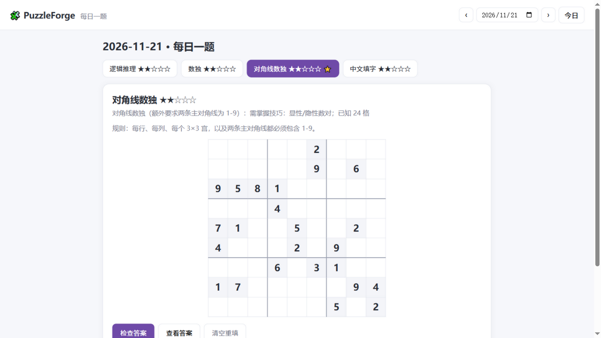
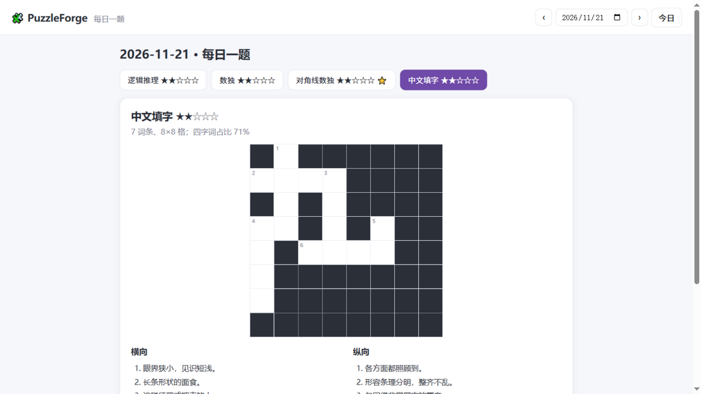
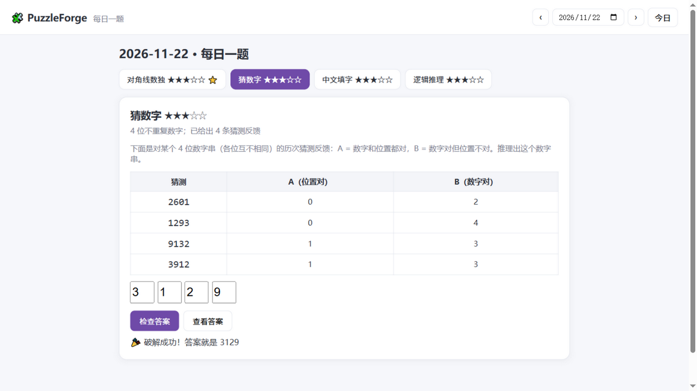

# 镜花水月 · 每日谜题（PuzzleForge）

[](https://daily-puzzle-kjct.zai.site)
[](#测试与验收)
[](#各题型唯一解与难度机制)

程序化生成**数独、对角线数独、逻辑推理、中文填字、密码谜题、猜数字**六类每日谜题：每题**自动验证唯一解**、**按难度 1-5 分级**、按日期确定性生成内容库，并自带可做题的「每日一题」网页。

**🌐 在线玩**：<https://daily-puzzle-kjct.zai.site> —— 手机/电脑均可，无需安装，每天 4 道随机题型。

## 界面预览

| 对角线数独 | 中文填字 | 猜数字 |
| --- | --- | --- |
|  |  |  |

> 每日页面自动展示当天随机抽中的 4 种题型，可在线做题、判分、看答案、翻阅往期。

两条架构第一原则：

1. **内容即接口**：生成器只产出规范 JSON（`content/日期.json`），网页/App/小程序直接消费同一内容库。
2. **题型插件化**：新增题型 = 在 `puzzleforge/types/` 下新建子包 + `@register` 装饰器，核心层零改动；契约测试自动覆盖新题型。

## 快速开始

```bash
# 生成今日内容（难度按日期轮换 1-5，题型按日期随机抽 4 种）
python -m puzzleforge generate --date 2026-11-21 --days 7

# 复核唯一解与答案一致性
python -m puzzleforge verify

# 本地预览网页（根目录启动，访问 http://localhost:8000/web/）
python -m http.server 8000
```

## CLI

| 命令 | 说明 |
| --- | --- |
| `python -m puzzleforge types` | 列出已注册题型 |
| `python -m puzzleforge generate --date YYYY-MM-DD [--days N] [--count 4] [--types sudoku,logic] [--difficulty 3]` | 生成内容库（`--types` 固定题型，否则按日期随机抽 `--count` 种） |
| `python -m puzzleforge verify` | 复核全部内容（唯一解 + 答案一致） |
| `python -m puzzleforge stats` | 内容库统计 |

## 各题型唯一解与难度机制

| 题型 | 生成方法 | 唯一解保证 | 难度分级 |
| --- | --- | --- | --- |
| 数独 | 随机满盘 → 控洞挖空 | 每挖一格用解计数器（搜到第 2 解即剪枝）验证 | 解题所需最高技巧：唯一候选(L1)→数对(L2)→三链数/区块(L3)→X-Wing(L4)→回溯(L5) |
| 对角线数独 | 同上 + 两条主对角线约束 | 对角线感知的解计数器 | 同数独分级 |
| 逻辑推理 | 随机指派 → 派生线索 → 贪心收敛 | 每步用二元 CSP 解计数验证，恰 1 解才接受 | 规模（3×2→5×3）+ 线索类型（高难度禁用直接肯定线索） |
| 中文填字 | 罕见字交叉生长（小词库也能出唯一解的关键） | 槽位 CSP 全枚举：词库范围内恰有 1 种填充 | 词条数 + 网格规模 + 四字词占比 |
| 密码谜题 | 算式谜题（精选经典 + 词池程序化组合）/ 拼音替换密码 | 算式暴力枚举恰 1 解；替换由构造保证 | 字母规模 / 明码提示比例（40%→8%） |
| 猜数字 (1A2B) | 随机秘密 + 线索贪心收敛与删减 | 对全部候选（P(10,L)）枚举计数恰为 1 | 位数 3/4/5 + 反馈条数 |

## 新鲜度保障（防重复）

- **内容指纹**：每个条目带 `fingerprint`——程序化题型用谜面哈希，题库型内容（名句/算式）用语义身份（名句本体、算式本身）。
- **生成即避重**：`generate` 默认扫描已有内容库，指纹撞车自动重摇（`--allow-repeat` 可关闭）。实测 30 天 × 题型 120 题零重复。
- **储量设计**：算式谜题 = 精选经典 + 词池程序化组合（运行时逐个暴力验证唯一解），候选近乎无限；名言库 200+ 条持续扩充；数独/逻辑/填字为程序化空间，实际不耗尽。
- 空间真正耗尽时 `create()` 接受重复并继续运行——长期新鲜度靠扩充词库/名言/词池维持。

## 新增题型指南

1. 在 `puzzleforge/types/` 下新建子包，如 `types/kenken/`；
2. `__init__.py` 里定义类继承 `PuzzleType`，实现 `generate(rng, difficulty)`（内部必须完成唯一解验证）与 `verify(puzzle, solution)`，并用 `@register` 装饰；
3. 完成——CLI、每日随机抽取、契约测试（`tests/test_contract.py`）自动纳入；网页端先用通用卡片展示，随后可在 `web/js/` 注册专用渲染组件。

`puzzleforge/common/csp.py` 提供带前向检查的二元约束求解器（解计数 / 唯一解），可直接复用。

## 目录结构

```
puzzleforge/
├── rng.py            # 日期种子确定性 RNG（新增题型不扰动既有内容）
├── schema.py         # 统一 JSON 信封
├── cli.py            # generate / types / verify / stats
├── history.py        # 内容指纹扫描（防重复）
├── common/csp.py     # 二元约束求解器（跨题型复用）
└── types/            # 题型插件：sudoku / sudokux / logic / crossword / crypto / guessnum
tests/                # 契约测试（遍历注册表）+ 单元测试
content/              # 生成产出：content/YYYY-MM-DD.json
web/                  # 每日一题页面（纯静态，无构建步骤）
docs/images/          # 界面截图
```

## 部署

站点以纯静态方式部署在 ZCode Sites（`https://daily-puzzle-kjct.zai.site`）：`web/` + `content/` 打包进 stage，用零依赖静态服务器启动。更新内容库后重建 stage 并重新执行 `zcode-site deploy .zcode-site/stage` 即可同步线上。

## 测试与验收

```bash
python -m pytest tests/ -q
```

- 契约测试遍历题型注册表：每个已注册题型 × 全难度档的唯一解验证、同日期字节级复现、JSON 往返
- 各题型与公共组件单元测试（CSP 解计数、数独分级、填字段提取、算式经典解、防重复指纹等）

## 路线图

每日一读（`type:"reading"` 已预留）→ 词库扩充脚本 → App/小程序壳复用同一 JSON 库 → 每日自动生成+自动部署定时任务。
